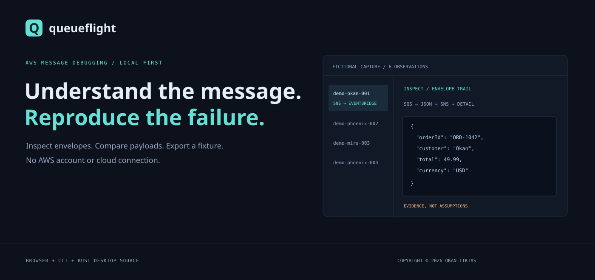

<div align="center">

# QueueFlight
### Understand the message. Reproduce the failure.

**A local workbench for SQS captures and Lambda event fixtures.**

Inspect envelopes · Compare payloads · Explore retry behavior · Export fixtures

[Quick start](#quick-start) · [Features](#what-you-can-do) · [CLI](#command-line) · [Desktop](docs/DESKTOP.md) · [AWS behavior](docs/AWS_BEHAVIOR.md)



**No AWS account · No credentials · No cloud connection · Copyright © 2026 OKAN TIKTAS**

</div>

An SQS capture is often several layers away from the application data you want to debug. QueueFlight follows SNS and EventBridge envelopes, makes repeat observations visible, and turns selected messages into local Lambda fixtures. Its retry lab helps explain the difference between failing a whole batch and returning partial failures.

It operates on the file you provide. It does not inspect a live queue or diagnose the cause of a failure from a receive counter alone.

## Quick start

Install **Node.js 24 or later**, extract this repository, and open a terminal in the folder containing `package.json`:

```sh
npm start
```

Open **http://127.0.0.1:4320**. A clearly labeled fictional checkout capture loads automatically. No `npm install` is needed for the browser app, build, CLI, or automated checks. Stop the server with Ctrl+C.

On Windows, type `cmd` into File Explorer's address bar while inside the extracted project folder, press Enter, and then run the command above. If npm's PowerShell shim is blocked, Command Prompt avoids that policy issue.

## What you can do

| View | Behavior |
| --- | --- |
| **Inspect** | Select a message, inspect metadata and SHA-256, and move through original body → parsed JSON → SNS Message → EventBridge detail. |
| **Compare** | Compare any two unwrapped payloads by JSON Pointer paths; missing values and null remain distinct. |
| **Retry lab** | Select up to ten records, mark hypothetical failures, and compare whole-batch, standard partial-batch, and conservative FIFO responses. |
| **Export fixture** | Download a selected message or checked batch in Lambda SQS event shape, preserving the original body. |

Supported inputs are AWS CLI/API `ReceiveMessage` JSON with `Messages`, Lambda SQS events with `Records`, arrays of message objects, or a single message with string `Body`/`body`. SNS-only and EventBridge-only documents must be contained in an SQS body for this release. Missing metadata is shown as missing rather than inferred.

Import is transactional: if one record is invalid, the entire new capture is rejected and the previous capture remains available. Message ordering follows input order. Select-all applies to the complete capture, including rows hidden by the text filter. The selection count makes the full export scope visible.

### A 30-second demo

1. Choose the first message: follow its SNS and EventBridge layers to Okan's order.
2. See that Phoenix's two observations have identical bodies, despite different message IDs.
3. Open **Compare** to examine two order payloads.
4. Open **Retry lab**, mark the third record as a hypothetical failure, then switch between response modes.
5. Export a fixture and inspect the exact original body in a local test harness.

The fixture does not unwrap the body automatically: your consumer should receive the same envelope it received in the capture.

## Important distinctions

- **Identical body** means SHA-256 of the raw UTF-8 body matches within this import. It is not proof that AWS delivered one logical message twice.
- **Repeated receives** means the supplied `ApproximateReceiveCount` string is at least three. Three is a UI attention threshold, not an AWS rule or proof of processing failure.
- **Plain text** is a valid SQS body. QueueFlight marks it for visibility, not as a malformed queue message.
- **Retry lab** is an educational model. It does not run your handler, model real timing/backoff, predict DLQ movement, or validate the deployed event source mapping.
- **FIFO** uses a conservative stop-at-first-failure example in the supplied batch order. It is not a complete message-group scheduler or FIFO emulator.

See [docs/AWS_BEHAVIOR.md](docs/AWS_BEHAVIOR.md) for the AWS references and limits behind those choices.

## Command line

Analyze a local capture:

```sh
node src/cli.ts analyze examples/sqs-demo.json
node src/cli.ts analyze examples/sqs-demo.json --out analysis.json
```

Export a fixture for the third imported observation (1-based), or the complete capture:

```sh
node src/cli.ts fixture examples/sqs-demo.json --index 3 --out local-fixture.json
node src/cli.ts fixture examples/sqs-demo.json --out full-fixture.json
```

Output files never overwrite existing destinations. POSIX outputs use mode `0600`; Windows uses its directory ACLs. Reports and fixtures include the imported body and can contain private data. Run `node src/cli.ts --help` for usage. Node 24 executes the TypeScript source directly; no compiler dependency is required.

## Static hosting, including Hostinger

The **`dist` folder is already built**. Upload its **contents** (`index.html`, `style.css`, `app.js`) into your domain's `public_html`, preserving those names. The files use relative paths, so a subfolder also works. Use HTTPS for clipboard access and SHA-256. You need no Node server on Hostinger.

The build keeps HTML, CSS, and JavaScript separate. It bundles the shared TypeScript engine and interface into one external `app.js`, so there is no `src` import path to lose during upload. Prefer a fresh subdomain or empty site folder; replacing `index.html` changes the website homepage.

After source edits, run `npm run build` and upload the new `dist` contents together. See [docs/HOSTING.md](docs/HOSTING.md).

## Desktop source

A **Tauri 2 / Rust desktop shell** uses the same built interface and analysis engine. Rust provides bounded native file import and native fixture save dialogs; the frontend never passes arbitrary filesystem paths to Rust. One shared TypeScript analysis engine keeps browser and desktop calculations consistent.

The desktop executable was **not compiled in the creation environment**, which lacks Rust and platform build tools. No installer or signed binary is included. Read [docs/DESKTOP.md](docs/DESKTOP.md) before using the source or running the manual Windows build workflow.

## Engineering and validation

```sh
npm run build
npm test
```

The current validation record contains **15 passing checks** for parsing, duplicate evidence, envelope preservation, fixtures, bounded diffing, retry responses, CLI behavior, HTTP boundaries, and built-interface handlers in a minimal DOM.

The interface integration test is not a real-browser test. A separate optional Playwright script is included for actual browser validation. Rust compilation, native dialogs, and live browser compatibility were not verified here. Read [docs/VALIDATION.md](docs/VALIDATION.md).

## Repository layout

```text
src/           Shared TypeScript engine and CLI
web/           Interface source: separate HTML, CSS, JavaScript
scripts/       Build, static server, optional browser check
src-tauri/     Rust native import/export commands and desktop config
dist/          Ready-built static website
examples/      Entirely fictional AWS-shaped captures
test/          Core, CLI, server and interface regression checks
docs/          AWS behavior, security boundaries, hosting and desktop guides
.github/       Automated checks and manual Windows build workflow
```

## Scope and contribution

This initial release intentionally focuses on local inspection. It does not contain AWS SDK clients, credentials, live redrive, queue deletion, message publishing, or automatic cloud remediation. Useful contributions include additional synthetic captures, accessibility review, message-attribute fixtures, and native desktop validation.

Please read [CONTRIBUTING.md](CONTRIBUTING.md) and [SECURITY.md](SECURITY.md). Built by **OKAN TIKTAS**. MIT licensed. QueueFlight is an independent project, not an AWS product or endorsement.
